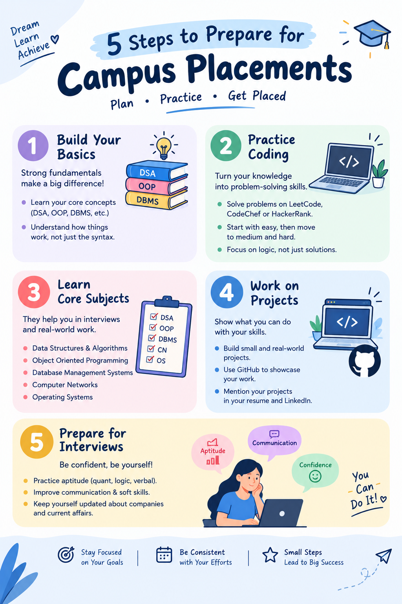

Infographic Creation

 Thiranex Internship – Final Task

 Project Title
5 Steps to Prepare for Campus Placements

 Project Overview
This infographic presents five important steps to prepare for campus placements in a simple and visually appealing way.

 Tool Used
- Canva

 Key Features
- Simple icons and illustrations
- Clear and organized information
- Easy-to-understand content
- Consistent colors and visual hierarchy
- Clean and beginner-friendly layout

 Steps Covered
1. Build Your Basics
2. Practice Coding
3. Learn Core Subjects
4. Work on Projects
5. Prepare for Interviews

 Learning Outcome
Through this task, I learned the basics of information design, data visualization, visual storytelling, and presenting concepts through graphics.

 Infographic Preview

 Internship
Thiranex – Infographic Creation Task
